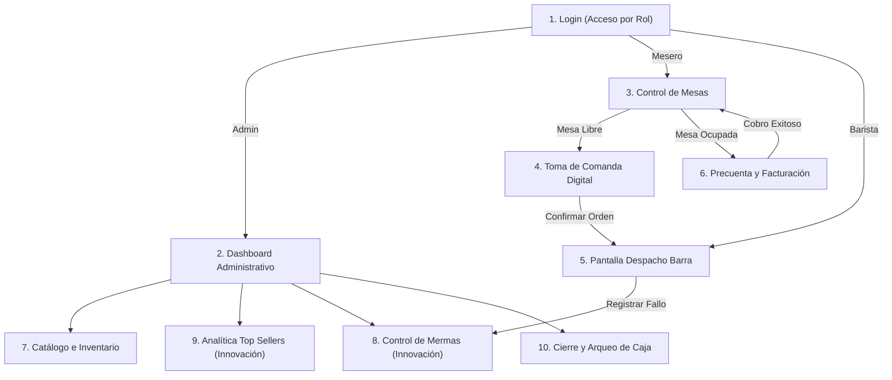

# SERVICIO NACIONAL DE APRENDIZAJE (SENA)
## CENTRO DE GESTIÓN DE MERCADOS, LOGÍSTICA Y TECNOLOGÍAS DE LA INFORMACIÓN
### TECNÓLOGO EN ANÁLISIS Y DESARROLLO DE SOFTWARE (ADSO)

---

# GUÍA DE DISEÑO UX/UI, SISTEMA DE DISEÑO Y PROTOTIPO (SESIÓN 4)
## PROYECTO: SISTEMA INTELIGENTE DE GESTIÓN "CAT-FÉ"
### ESTABLECIMIENTO: CAFETERÍA DE ESPECIALIDAD "STAR-LIGHT"

* **Aprendiz:** Brayan Santiago Cuta
* **Instructora:** Joan Castillo Celis
* **Ficha de Caracterización:** ADSO
* **Fecha:** Noviembre de 2026
* **Herramienta de Diseño:** Figma (Desktop 1440px / Mobile 390px)
* **Repositorio GitHub:** [Cafeteria-Inteligente-Cat-fe](https://github.com/brayansantiagocuta-eng/Cafeteria-Inteligente-Cat-fe)

---

## 1. IDENTIDAD VISUAL Y SISTEMA DE DISEÑO

### 1.1 Paleta de Colores Oficial (Inspiración Café de Especialidad & Felino Elegante)

| Muestra / Rol | Nombre del Tono | Código Hex | Uso en la Interfaz (Bootstrap / CSS) |
| :--- | :--- | :---: | :--- |
| **Color Primario** | Café Espresso Oscuro | `#2C1810` | Barras de navegación superior, títulos principales, botones primarios y branding. |
| **Color Secundario** | Caramelo Dorado / Ámbar | `#C88A58` | Botones de acción secundaria, estados de advertencia, iconos destacados y badges. |
| **Acento Felino** | Crema Vainilla Suave | `#F5EBE1` | Fondos de tarjetas, modales, barras laterales secundarias y contrastes suaves. |
| **Fondo General** | Blanco Hueso / Off-White | `#F8F9FA` | Fondo general de las pantallas para garantizar máxima legibilidad y descanso visual. |
| **Estado Éxito** | Verde Menta / Disponible | `#28A745` | Mesas disponibles, pedidos entregados, inventario en stock óptimo. |
| **Estado Alerta** | Naranja / En Preparación | `#FD7E14` | Mesas ocupadas, pedidos en proceso en barra, insumos con caducidad próxima (< 48h). |
| **Estado Peligro** | Rojo Carmín / Merma | `#DC3545` | Mesas por cobrar, productos agotados, registro de pérdidas/mermas. |
| **Texto Principal** | Antracita Neutro | `#212529` | Tipografía de lectura, párrafos y datos numéricos de facturación. |

---

### 1.2 Tipografía Oficial (Máximo 2 Fuentes)

1. **Fuente de Títulos y Encabezados:** `Poppins` (Google Fonts)
   * *Pesos utilizados:* SemiBold (600), Bold (700).
   * *Propósito:* Aporta modernidad, cercanía y una presencia geométrica limpia para marcas gastronómicas modernas.
2. **Fuente de Cuerpo y Datos Numéricos:** `Inter` (Google Fonts)
   * *Pesos utilizados:* Regular (400), Medium (500).
   * *Propósito:* Máxima legibilidad en tablas de facturación, listas de ingredientes, precios e interfaces de punto de venta (POS).

---

## 2. ESPECIFICACIÓN DE LAS 10 PANTALLAS DEL SISTEMA

Cada pantalla está diseñada con arquitectura responsive en dos resoluciones obligatorias:
* **Escritorio:** 1440 px × 1024 px (Orientado a pantalla de caja, barra y administración).
* **Móvil / Tablet:** 390 px × 844 px (Orientado al mesero en salón y consulta en smartphones).

---

### Pantalla 1: Login / Inicio de Sesión
* **Objetivo:** Autenticación segura de usuarios y redirección automática según rol (`Administrador`, `Mesero`, `Barista`).
* **Componentes Visuales:**
  * Logotipo centrado de **Cat-fé 🐾☕** sobre fondo Crema Vainilla (`#F5EBE1`).
  * Card centrada con sombra suave (`shadow-sm`).
  * Input de Usuario/Correo electrónico con icono de usuario.
  * Input de Contraseña con botón de alternar visibilidad (ojo).
  * Selector visual rápido de perfil para pruebas o demo.
  * Botón primario de "Acceder al Sistema" en Café Espresso (`#2C1810`).
  * Alertas dinámicas de error en caso de credenciales inválidas.

---

### Pantalla 2: Dashboard Administrativo Principal
* **Objetivo:** Panel de control gerencial con indicadores clave de rendimiento (KPIs) en tiempo real.
* **Componentes Visuales:**
  * Barra superior (*Navbar*) con datos de usuario activo, rol y botón de cierre de sesión.
  * 4 Tarjetas de resumen métrico:
    1. Ventas acumuladas de la jornada ($).
    2. Mesas ocupadas vs. disponibles (ej. 6/10 ocupadas).
    3. Total monetario de mermas del día ($) con indicador de alerta.
    4. Alerta de insumos próximos a caducar (< 48 horas).
  * Acceso directo a reportes, gestión de carta y cierre de caja.

---

### Pantalla 3: Salón y Control Visual de Mesas (Vista del Mesero)
* **Objetivo:** Monitoreo táctil y en tiempo real del estado de cada mesa del salón de Star-Light.
* **Componentes Visuales:**
  * Grilla interactiva de mesas (Mesa 1 a Mesa 12).
  * Código semáforo de colores por tarjeta de mesa:
    * **Verde (`#28A745`):** Mesa Libre / Disponible.
    * **Naranja (`#FD7E14`):** Mesa Ocupada (con tiempo transcurrido desde la orden).
    * **Rojo (`#DC3545`):** Mesa con Precuenta Solicitada / Pendiente de Cobro.
  * Botón flotante para "Cambiar / Trasladar Mesa" (HU-11).
  * Al hacer clic en una mesa libre se abre la toma de comanda; al hacer clic en una ocupada se ve el consumo en curso.

---

### Pantalla 4: Toma de Comanda Digital y Menú Táctil
* **Objetivo:** Selección ágil de productos y bebidas con adiciones para envío inmediato a la barra.
* **Componentes Visuales:**
  * Pestañas de categorías: *Cafés de Especialidad*, *Bebidas Frías*, *Repostería*, *Snacks*.
  * Catálogo de productos en tarjetas táctiles con foto, nombre, precio y badge de stock.
  * Inhabilitación visual en gris con badge "AGOTADO" para productos con stock 0 (RN-01).
  * Panel lateral derecho con el resumen de la orden:
    * Ítems seleccionados, cantidades (+ / -).
    * Campo de notas u observaciones especiales (ej. "Leche de almendra, sin azúcar").
    * Subtotal calculado en vivo.
    * Botón de confirmación: "Enviar Pedido a Barra ☕".

---

### Pantalla 5: Pantalla de Despacho para Barra / Cocina (Kitchen Display System - KDS)
* **Objetivo:** Proyección cronológica de las comandas entrantes para preparación por el barista.
* **Componentes Visuales:**
  * Tablero Kanban horizontal con tarjetas de comanda ordenadas por hora de llegada.
  * Encabezado de comanda: Número de Mesa, tiempo de espera en minutos (con cambio de color si supera 8 min).
  * Lista de bebidas y alimentos con sus notas destacadas en color dorado (`#C88A58`).
  * Botón interactivo: "Iniciar Preparación".
  * Botón final: "Marcar como Despachado / Listo" (notifica al mesero y bloquea cancelaciones - RN-04).

---

### Pantalla 6: Precuenta, Facturación y Cierre de Mesa
* **Objetivo:** Liquidación transparente de los consumos de la mesa y emisión del comprobante.
* **Componentes Visuales:**
  * Encabezado con datos del negocio (Star-Light, NIT, Dirección, Fecha y Hora).
  * Tabla discriminada: Cantidad, Producto, Precio Unitario, Total.
  * Desglose de Subtotal, Impuestos (Impoconsumo / IVA) y Total a Pagar en pesos colombianos ($).
  * Selector de Medio de Pago: `[ Efectivo ]` `[ Transferencia / Nequi ]` `[ Datáfono / Tarjeta ]`.
  * Campo para registrar valor recibido y cálculo automático del cambio/vueltas en efectivo.
  * Botón de acción: "Finalizar Venta y Liberar Mesa".

---

### Pantalla 7: Catálogo de Productos e Inventario
* **Objetivo:** Administración CRUD de artículos, precios, costos y existencias físicas.
* **Componentes Visuales:**
  * Barra de búsqueda reactiva por nombre y filtro por categoría.
  * Botón superior: "+ Nuevo Producto".
  * Tabla de inventario: Código, Imagen, Nombre, Categoría, Precio Venta, Costo Insumo, Stock Actual, Estado.
  * Badge de alerta naranja en insumos con fecha de caducidad menor a 48 horas (HU-12).
  * Acciones por fila: Editar, Ajustar Stock, Inactivar.

---

### Pantalla 8 (Innovación): Módulo de Control de Mermas y Desperdicios
* **Objetivo:** Registro tipificado de pérdidas de insumos y evaluación del impacto económico.
* **Componentes Visuales:**
  * Formulario de registro rápido en barra:
    * Selector de producto o insumo dado de baja.
    * Cantidad desechada y unidad (gr, ml, unidades).
    * Selector obligatorio de causal de merma: `Caducidad`, `Error de Preparación`, `Accidente/Deterioro` (RN-03).
    * Campo de cálculo automático: Muestra en tiempo real la pérdida monetaria (`cantidad × costo`).
  * Historial de mermas registradas con fecha, hora, usuario responsable y valor acumulado.

---

### Pantalla 9 (Innovación): Dashboard Analítico de Productos Más Vendidos (Top Sellers)
* **Objetivo:** Análisis de demanda para compras estratégicas a proveedores y venta sugerida.
* **Componentes Visuales:**
  * Selector de periodicidad: `[ Hoy ]` `[ Esta Semana ]` `[ Este Mes ]` `[ Rango Personalizado ]`.
  * Gráfico de barras horizontal: Top 5 de bebidas y alimentos con mayor volumen de unidades vendidas.
  * Gráfico de dona: Participación de ingresos por categoría (% cafés vs. repostería).
  * Tabla analítica detallada: Posición (Ranking 1 al 10), Nombre, Unidades Vendidas, Ingresos Totales Generados, Margen de Contribución.

---

### Pantalla 10: Arqueo y Cierre de Caja Diario
* **Objetivo:** Consolidación de ingresos del turno e inmutabilidad contable de la jornada (RN-05).
* **Componentes Visuales:**
  * Resumen de caja:
    * Fondo inicial de caja (base).
    * Total recaudado en Efectivo.
    * Total recaudado por Transferencias (Nequi / Daviplata).
    * Total recaudado por Datáfono / Tarjetas.
    * Total de pérdidas por mermas registradas en el turno.
    * Gran Total Neto de Caja.
  * Campo para conteo físico de efectivo y cálculo de diferencia (Sobrante / Faltante).
  * Botón definitivo: "Confirmar Arqueo y Bloquear Turno" (con advertencia modal de inmutabilidad).

---

## 3. COMPONENTES REUTILIZABLES (UI KIT)

Para garantizar consistencia visual en Figma y su posterior maquetación en Bootstrap 5:
* **Botones:** Primario (`#2C1810`), Secundario (`#C88A58`), Peligro/Merma (`#DC3545`), Éxito (`#28A745`).
* **Badges de Estado:** Pills con bordes redondeados para estados de mesa, stock y pedidos.
* **Cards Gastronómicas:** Contenedores con bordes redondeados de 12px, sombra tenue y contraste sobre `#F8F9FA`.
* **Modales:** Precuenta, confirmación de traslado de mesa y confirmación de baja de mermas.

---

## 4. MAPA DE NAVEGACIÓN DEL PROTOTIPO (USER FLOW)

---

## 5. EVIDENCIAS ASOCIADAS
* **Documento versionado en Git:** `docs/figma_design.md`.
* **Prototipo Figma:** Estructura de 10 pantallas con versiones Desktop (1440px) y Mobile (390px).
* **Commit asociado:** `docs: documentar guia de diseño UI/UX y prototipo Figma de 10 pantallas`.
