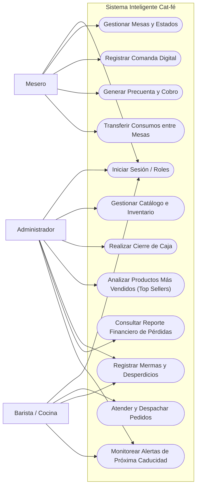

# SERVICIO NACIONAL DE APRENDIZAJE (SENA)
## CENTRO DE GESTIÓN DE MERCADOS, LOGÍSTICA Y TECNOLOGÍAS DE LA INFORMACIÓN
### TECNÓLOGO EN ANÁLISIS Y DESARROLLO DE SOFTWARE (ADSO)

---

# ESPECIFICACIÓN DE REQUISITOS DE SOFTWARE (SESIÓN 2)
## NORMA DE REFERENCIA: ISO/IEC/IEEE 29148:2018
### PROYECTO: SISTEMA INTELIGENTE DE GESTIÓN "CAT-FÉ"
#### ESTABLECIMIENTO: CAFETERÍA DE ESPECIALIDAD "STAR-LIGHT"

* **Aprendiz:** Brayan Santiago Cuta
* **Instructora:** Joan Castillo Celis
* **Ficha de Caracterización:** ADSO
* **Fecha:** Noviembre de 2026
* **Repositorio GitHub:** [Cafeteria-Inteligente-Cat-fe](https://github.com/brayansantiagocuta-eng/Cafeteria-Inteligente-Cat-fe)

---

## 1. FORMULACIÓN DEL PROBLEMA

### 1.1 Descripción del Problema
La cafetería de especialidad **Star-Light** enfrenta pérdidas económicas y demoras operativas significativas debido a la administración manual de sus comandas, la ausencia de control en el inventario perecedero y la falta de información estratégica de ventas. El 70% de los clientes percibe demoras en horas pico al usar comandas en papel, mientras que el 90% ha experimentado el agotamiento inesperado de productos ya ordenados. Adicionalmente, el descarte de insumos (leches vegetales, repostería artesanal y café mal extraído) se efectúa sin registro de causas ni cálculo de pérdidas monetarias, impidiendo optimizar compras a proveedores y maximizar la rentabilidad.

### 1.2 Pregunta Problema
¿De qué manera un sistema web con arquitectura MVC, desarrollado en PHP y MySQL, permite optimizar la toma de pedidos, sincronizar el inventario en tiempo real, identificar los productos de mayor rotación y controlar el desperdicio de insumos en la cafetería Star-Light?

### 1.3 Justificación
El desarrollo del software **Cat-fé** erradica los cuellos de botella en la atención a mesas mediante comandas digitales directas a barra, protege el margen de utilidad mediante la tipificación y cuantificación financiera de mermas (desperdicios), e impulsa las ventas mediante un módulo analítico de productos estrella (*Top Sellers*). Esto fortalece la sostenibilidad operativa del negocio y eleva la satisfacción de los clientes.

### 1.4 Objetivo General
Desarrollar un sistema de información web bajo arquitectura MVC con PHP 8+, MySQL, Bootstrap 5 y JavaScript para la cafetería Star-Light, que integre la administración de productos, mesas, pedidos, ventas, análisis de rotación de productos más vendidos y control de mermas/desperdicios, cumpliendo con el estándar ISO/IEC/IEEE 29148:2018.

### 1.5 Objetivos Específicos
1. Diseñar el modelo de datos relacional normalizado (3FN) en MySQL Workbench para soportar usuarios, mesas, productos, pedidos, ventas y mermas.
2. Desarrollar el módulo de atención en salón con gestión de estados de mesa (`Disponible`, `Ocupada`, `Por cobrar`) y comanda digital inmediata a la barra.
3. Construir la funcionalidad innovadora de **Análisis de Productos Más Vendidos** mediante consultas de agregación SQL para orientar el abastecimiento y la venta sugerida.
4. Implementar la funcionalidad innovadora de **Control y Tipificación de Desperdicios / Mermas**, calculando el impacto financiero de las pérdidas por caducidad, preparación o manipulación.
5. Garantizar la seguridad, integridad y trazabilidad del sistema mediante autenticación segura con contraseñas cifradas y control de acceso basado en roles (RBAC).

### 1.6 Alcance del Sistema
* Módulo de autenticación y roles (`Administrador`, `Mesero`, `Barista/Cocina`).
* Módulo de catálogo de productos e insumos con stock y alertas de mínimo.
* Módulo de gestión visual de mesas y comandas digitales.
* Módulo de facturación, caja diaria y medios de pago.
* **Módulo innovador 1:** Dashboard analítico con ranking y métricas de productos más vendidos.
* **Módulo innovador 2:** Registro, tipificación y costeo de mermas/desperdicios.

### 1.7 Limitaciones
* El sistema operará inicialmente en red de área local (LAN) o entorno de servidor web local XAMPP.
* No incluye integración directa con pasarelas de pago bancarias en línea (PSE, Stripe); se gestionan registros de pago por efectivo, transferencia (Nequi/Daviplata) o datáfono.
* No reemplaza el software contable tributario externo para facturación electrónica DIAN en su primera fase.

---

## 2. TABLA DE ACTORES DEL SISTEMA

| Actor | Responsabilidad en el Negocio | Nivel de Acceso e Interacción con Cat-fé |
| :--- | :--- | :--- |
| **Administrador** | Dirección general, compras, precios, inventario y balance económico. | Acceso total: gestión de usuarios, catálogo, reportes de ventas, analítica de más vendidos, auditoría de mermas y caja. |
| **Mesero** | Recepción de comensales, toma de pedidos en mesa y cobro. | Asignación de mesas, levantamiento de comanda digital, emisión de precuenta y registro del método de pago. |
| **Barista / Cocina** | Elaboración de bebidas y alimentos, verificación de frescura. | Visualización en vivo de comandas pendientes/en preparación, despacho de órdenes y registro de mermas operativas. |

---

## 3. REQUISITOS DEL SOFTWARE (ISO/IEC/IEEE 29148:2018)

### 3.1 Requisitos Funcionales (RF)

| ID | Nombre del Requisito | Descripción Funcional | Prioridad | Criterio de Aceptación |
| :---: | :--- | :--- | :---: | :--- |
| **RF-01** | Autenticación y control de roles | El sistema permite el inicio de sesión con usuario/correo y contraseña cifrada, restringiendo vistas y módulos según el rol (`Administrador`, `Mesero`, `Barista`). | Alta | Dado un usuario válido, el sistema redirige al dashboard de su rol; si las credenciales son erróneas, muestra alerta de acceso denegado. |
| **RF-02** | Gestión de catálogo de productos | El sistema permite crear, leer, actualizar e inactivar (CRUD) productos con nombre, categoría, precio de venta, costo base, stock y unidad de medida. | Alta | Al guardar un producto con datos válidos, aparece de inmediato en la lista del menú y en la base de datos. |
| **RF-03** | Control de estado de mesas | El sistema permite visualizar y cambiar el estado de las mesas en tiempo real (`Disponible`, `Ocupada`, `Cuenta solicitada`, `Mantenimiento`). | Alta | Al asignar un comensal a una mesa disponible, su estado visual cambia a "Ocupada" impidiendo doble asignación. |
| **RF-04** | Registro de comanda digital | El sistema permite al mesero seleccionar la mesa, agregar productos con cantidades y observaciones (ej. "leche de almendra, sin azúcar") y enviar el pedido. | Alta | Al confirmar la comanda, esta se asocia a la mesa activa y se lista instantáneamente en la pantalla de barra/cocina. |
| **RF-05** | Pantalla de despacho para barra/cocina | El sistema proyecta las comandas entrantes ordenadas por hora de llegada, permitiendo al barista marcar productos como `En preparación` o `Despachado`. | Alta | Al cambiar el estado de un pedido a "Despachado", se actualiza la vista de barra y notifica que está listo para entrega. |
| **RF-06** | Precuenta y facturación de mesa | El sistema calcula el total de la mesa sumando los ítems consumidos, impuestos y descuentos aplicables, emitiendo la precuenta y el comprobante de pago. | Alta | La sumatoria matemática de los productos coincide al centavo con el total facturado y libera la mesa a "Disponible" al pagar. |
| **RF-07** | Registro de medios de pago y cierre de caja | El sistema permite registrar cobros discriminando medio de pago (`Efectivo`, `Transferencia`, `Datáfono`) y genera el balance de ventas de la jornada. | Alta | El reporte de cierre diario muestra el consolidado desglosado por cada medio de pago sin descuadres. |
| **RF-08** | Descuento automático de inventario | El sistema descuenta las existencias físicas del producto o insumo al confirmar una venta o despacho. | Alta | Si un producto tiene stock 10 y se venden 2, el inventario reflejará automáticamente 8 unidades. |
| **RF-09** | Bloqueo automático por stock mínimo | El sistema impide la venta o selección de productos cuyo inventario sea 0 o alcance el umbral de seguridad, mostrando advertencia de "Agotado". | Media | Dado un producto con stock 0, el botón de agregar a la comanda queda deshabilitado en la vista del mesero. |
| **RF-10** | **Análisis de productos más vendidos (Top Sellers)** | El sistema genera estadísticas, tablas y gráficos de los productos con mayor volumen de venta y rentabilidad en rangos de fecha seleccionados. | **Alta (Innovación)** | Al consultar un rango de fechas, el sistema lista el Top 5/10 de productos ordenados por cantidad vendida y monto total recaudado. |
| **RF-11** | **Registro y tipificación de mermas/desperdicios** | El sistema permite registrar insumos o productos desechados indicando producto, cantidad, motivo (`Caducidad`, `Error de preparación`, `Accidente`) y responsable. | **Alta (Innovación)** | Al guardar una merma, el sistema descuenta el stock del inventario y calcula automáticamente la pérdida monetaria basada en el costo unitario. |
| **RF-12** | **Reporte de costo de desperdicios** | El sistema consolida informes financieros de pérdidas por desperdicio agrupadas por motivo, categoría y fechas, calculando el impacto en el margen del negocio. | **Alta (Innovación)** | El informe muestra el total de pérdidas en pesos ($) y el porcentaje atribuible a cada causa de merma durante el período consultado. |

---

### 3.2 Requisitos No Funcionales (RNF)

| ID | Parámetro | Requisito No Funcional | Criterio de Medición |
| :---: | :--- | :--- | :--- |
| **RNF-01** | Rendimiento y Tiempo de Respuesta | Las consultas de mesas, envío de comandas y generación de reportes no deben superar 2 segundos en red local. | Tiempo de carga inferior a 2.0 s verificado en DevTools / Red. |
| **RNF-02** | Seguridad y Cifrado de Datos | Las contraseñas deben almacenarse en la base de datos cifradas mediante algoritmo `BCRYPT` (`password_hash` de PHP). | Ninguna contraseña en texto plano en la tabla `usuario`. |
| **RNF-03** | Usabilidad y Diseño Responsive | La interfaz web debe adaptarse fluidamente a pantallas de escritorio (1440px), tablets (768px) y móviles (390px) usando Bootstrap 5. | Visualización correcta sin desbordamiento horizontal en diferentes viewports. |
| **RNF-04** | Integridad y Prevención SQL | Toda interacción con MySQL debe implementarse mediante PDO con sentencias preparadas (*Prepared Statements*). | Cero concatenaciones de variables en consultas SQL para evitar SQL Injection. |
| **RNF-05** | Compatibilidad de Navegadores | El sistema debe funcionar de manera homogénea en navegadores modernos (Google Chrome, Mozilla Firefox y Microsoft Edge). | Ejecución completa de flujos sin incompatibilidad de JavaScript o CSS. |
| **RNF-06** | Disponibilidad y Arquitectura Limpia | La solución debe estructurarse bajo el patrón Modelo-Vista-Controlador (MVC) nativo en PHP 8+, garantizando mantenibilidad y desacoplamiento. | Estructura de carpetas limpia y separación estricta entre consultas PDO, lógica de control y vistas HTML. |

---

## 4. HISTORIAS DE USUARIO (HU)

| ID | Historia de Usuario (Como / Quiero / Para) | Criterios de Aceptación (Dado / Cuando / Entonces) | Prioridad |
| :---: | :--- | :--- | :---: |
| **HU-01** | **Como** Administrador, **quiero** iniciar sesión con mis credenciales seguras **para** acceder a los paneles de gestión y configuración del sistema. | **Dado** un usuario y contraseña válidos, **cuando** presiono "Iniciar Sesión", **entonces** accedo al dashboard principal con todas las opciones habilitadas. | Alta |
| **HU-02** | **Como** Mesero, **quiero** visualizar el mapa de mesas con colores según su estado **para** ubicar clientes en mesas libres y saber cuáles están ocupadas. | **Dado** el panel de mesas, **cuando** ingreso, **entonces** veo en color verde las mesas disponibles y en color rojo las mesas con órdenes activas. | Alta |
| **HU-03** | **Como** Mesero, **quiero** registrar una comanda digital seleccionando productos y notas **para** que el pedido se envíe de inmediato a la barra sin usar papel. | **Dado** una mesa ocupada, **cuando** agrego 2 capuchinos con nota "leche de almendra" y confirmo, **entonces** el pedido aparece en la pantalla del barista. | Alta |
| **HU-04** | **Como** Barista, **quiero** ver los pedidos ordenados cronológicamente y marcar los preparados **para** organizar los despachos de café con rapidez. | **Dado** un pedido en espera, **cuando** termino su preparación y pulso "Listo", **entonces** cambia a estado despachado y se notifica al mesero. | Alta |
| **HU-05** | **Como** Mesero, **quiero** generar la precuenta de una mesa **para** presentar el valor exacto y detallado al cliente antes de procesar el cobro. | **Dado** una mesa con consumos, **cuando** pulso "Generar Precuenta", **entonces** el sistema emite el desglose de productos y el total a pagar sin tachones. | Alta |
| **HU-06** | **Como** Administrador, **quiero** registrar compras e inventario inicial de productos **para** mantener el stock actualizado automáticamente. | **Dado** un producto en el catálogo, **cuando** actualizo sus existencias y costo, **entonces** el sistema actualiza la cantidad física disponible. | Alta |
| **HU-07** | **Como** Barista / Administrador, **quiero** registrar la merma de una leche o postre dañado indicando el motivo **para** dar de baja el insumo y reflejar la pérdida real. | **Dado** un insumo vencido, **cuando** registro cantidad y motivo "Caducidad", **entonces** el inventario descuenta las unidades y se archiva el costo perdido. | **Alta (Innovación)** |
| **HU-08** | **Como** Administrador, **quiero** consultar el ranking de los productos más vendidos **para** planificar las compras semanales con proveedores de café y repostería. | **Dado** un rango de fechas (ej. último mes), **cuando** genero el reporte Top Sellers, **entonces** el sistema lista los artículos más vendidos con gráficos de rotación. | **Alta (Innovación)** |
| **HU-09** | **Como** Administrador, **quiero** consultar el reporte financiero de desperdicios **para** identificar en qué área (caducidad o preparación) se está perdiendo más dinero. | **Dado** el módulo de mermas, **cuando** filtro por mes, **entonces** visualizo el total de dinero perdido ($) y el porcentaje atribuible a cada causa. | **Alta (Innovación)** |
| **HU-10** | **Como** Administrador / Cajero, **quiero** realizar el cierre de caja diario **para** verificar que el dinero recibido en efectivo y datáfono cuadre con las ventas registradas. | **Dado** el final del turno, **cuando** selecciono "Cerrar Caja", **entonces** el sistema totaliza los ingresos por método de pago y bloquea modificaciones en ese turno. | Alta |
| **HU-11** | **Como** Mesero, **quiero** transferir la orden activa de una mesa a otra cuando un cliente decida reubicarse de lugar en el salón **para** mantener el historial de consumos y la cuenta unificada sin tener que reingresar los pedidos. | **Dado** una mesa origen con consumos pendientes y una mesa destino libre, **cuando** selecciono la opción "Cambiar Mesa", **entonces** todos los pedidos se trasladan automáticamente a la nueva mesa y la anterior queda disponible. | Media |
| **HU-12** | **Como** Administrador, **quiero** configurar alertas visuales de caducidad próxima en insumos perecederos **para** promoverlos con ofertas especiales antes de que se conviertan en desperdicio o merma. | **Dado** un producto con fecha de vencimiento menor a 48 horas, **cuando** ingreso al panel de inventario, **entonces** el sistema lo resalta en color naranja y genera una notificación de acción preventiva. | **Alta (Innovación)** |

---

## 5. REGLAS DE NEGOCIO (RN)

### RN-01: Control de Disponibilidad e Inhabilitación de Ventas
> **Descripción:** Ningún producto o ingrediente con stock igual a cero (`stock <= 0`) puede ser añadido a una nueva comanda. El sistema debe inhabilitar la opción en la interfaz del mesero y emitir una alerta sonora/visual de "Producto Agotado", impidiendo discrepancias con el cliente en mesa.

### RN-02: Integridad del Flujo de Mesas y Facturación
> **Descripción:** Una mesa en estado `Ocupada` no puede cerrarse ni quedar en estado `Disponible` hasta que la comanda asociada haya sido liquidada en su totalidad con un medio de pago válido (`Efectivo`, `Transferencia` o `Datáfono`), o bien anulada expresamente por el usuario con rol `Administrador` registrando una justificación obligatoria.

### RN-03: Autorización y Costeo Obligatorio de Mermas
> **Descripción:** Todo registro de merma o desperdicio debe tipificarse obligatoriamente bajo una de las tres causales autorizadas: `Caducidad`, `Error de Preparación` o `Accidente/Deterioro`. El sistema calculará de forma automática el valor económico de la pérdida multiplicando la cantidad desechada por el costo unitario de compra (`perdida_total = cantidad * costo_unitario`), impactando directamente el estado de pérdidas operativas del turno.

### RN-04: Bloqueo de Modificación de Comandas en Estado Despachado
> **Descripción:** Una vez que el barista o cocinero marca un producto de la comanda como `Despachado` o `En Preparación`, dicho ítem no puede ser eliminado ni modificado por el mesero desde el salón. Cualquier anulación de un producto en este estado requiere autorización del `Administrador` y genera automáticamente una merma operativa por costo de preparación fallida o producto devuelto.

### RN-05: Inmutabilidad del Arqueo y Cierre de Caja
> **Descripción:** Una vez que el `Administrador` o cajero ejecuta el cierre diario de caja de un turno, todos los registros de ventas, consumos y pagos asociados a esa jornada quedan en estado de solo lectura (bloqueo de edición y eliminación). Cualquier ajuste posterior debe registrarse como un movimiento extraordinario de ajuste contable debidamente auditado con fecha, hora y usuario responsable.

---

## 6. DIAGRAMA DE CASOS DE USO (DESCRIPCIÓN TEXTUAL Y RELACIONES)

---

## 7. EVIDENCIAS ASOCIADAS
* **Documento versionado en Git:** `docs/requisitos.md`.
* **Estándar aplicado:** ISO/IEC/IEEE 29148:2018 (Ingeniería de Requisitos).
* **Commit asociado:** `docs: ampliar requisitos con 12 HU y 5 reglas de negocio para Cat-fe`.
